# Fase 2 · Design UI/UX e Prototipagem

[← Voltar ao README](../README.md) · Anterior: [Requisitos](02-requisitos.md) · Próxima: [Guia de estilo](04-guia-de-estilo.md)

## 1. Personas

Proto-personas criadas pela equipe a partir da pesquisa do professor e da pesquisa de campo. Os nomes são fictícios.

### Persona 1 · Marcos, o motorista que roda muito

| | |
|---|---|
| **Idade e cidade** | 34 anos, Curitiba (PR) |
| **Trabalho** | Representante comercial; roda cerca de 2.000 km por mês, metade na estrada |
| **Carro atual** | Hatch 1.0 a gasolina, 2019 |
| **Objetivo** | Trocar de carro em 2027 gastando menos por mês |
| **Dores** | Gasta muito com combustível; ouviu que elétrico "se paga", mas não sabe em quanto tempo; tem medo da autonomia na estrada |
| **Como decide hoje** | Vídeos no YouTube e conversa com amigos; nunca fez a conta completa |
| **O que precisa ver** | Custo por mês, custo por km e em quantos anos a diferença de preço volta |
| **Frase** | "Se eu pagar mais caro agora, quando é que eu empato?" |

### Persona 2 · Fernanda, a primeira compra

| | |
|---|---|
| **Idade e cidade** | 27 anos, região metropolitana de Curitiba |
| **Trabalho** | Analista administrativa; roda 900 km por mês, quase tudo na cidade |
| **Carro atual** | Nenhum; vai comprar o primeiro carro |
| **Objetivo** | Escolher entre um popular a combustão e um elétrico compacto |
| **Dores** | Não entende consumo em km/kWh; não sabe quanto vai pagar de seguro e IPVA; mora em apartamento e talvez carregue no trabalho |
| **Como decide hoje** | Sites de concessionárias e simuladores de financiamento |
| **O que precisa ver** | Explicação simples dos custos e comparação lado a lado |
| **Necessidade de acessibilidade** | Usa óculos e prefere texto maior e tema claro |
| **Frase** | "Eu só quero saber qual sai mais barato pra mim, sem planilha." |

### Persona 3 · Seu Valdir, o mecânico (especialista)

| | |
|---|---|
| **Idade e cidade** | 52 anos, Curitiba |
| **Papel** | Dono de oficina; clientes pedem opinião antes de trocar de carro |
| **Objetivo** | Mostrar ao cliente os números de manutenção de forma clara |
| **Dores** | Clientes ignoram o custo de manutenção e desvalorização |
| **O que precisa ver** | De onde vêm os números (fontes) e que dá para ajustar os valores |

## 2. Jornada do usuário (Marcos)

| Etapa | O que ele faz | O que pensa / sente | Ponto de contato | Oportunidade no sistema |
|---|---|---|---|---|
| 1. Descoberta | Pesquisa "vale a pena carro elétrico" | Confuso, cada vídeo diz uma coisa | Google, redes sociais | Página clara com a pergunta "qual sai mais barato pra ti?" |
| 2. Entrada | Abre o Turbo e Taxa e escolhe o carro dele | "Será que vou ter que preencher muita coisa?" | Tela Simular | Só um carro basta; o resto o sistema sugere |
| 3. Configuração | Informa km/mês, % cidade e anos | Preços já vêm preenchidos, alívio | Passos 2 e 3 | Valores de Curitiba prontos e editáveis |
| 4. Resultado | Vê o destaque com a economia e o payback | "Bah, então o elétrico se paga em 4 anos!" | Tela Resultado | Destaque em reais, cartões lado a lado, gráfico ano a ano |
| 5. Confiança | Abre "Como calculamos" | Quer entender antes de acreditar | Tela Como calculamos | Fórmulas em linguagem simples e fontes |
| 6. Retorno | Salva a simulação e volta outro dia com outro cenário | Quer comparar com o carro da esposa | Minhas simulações | Salvar, abrir e apagar |

## 3. Fluxo de navegação

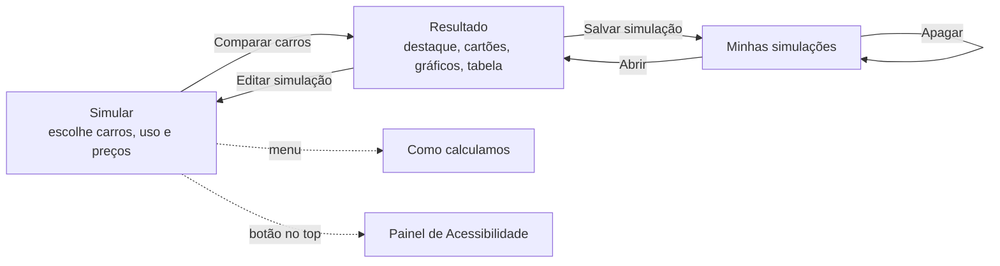

## 4. Protótipo de baixa fidelidade (wireframes)

Esboços estruturais das três telas principais, sem cores nem conteúdo final.

**Tela 1 · Simular**

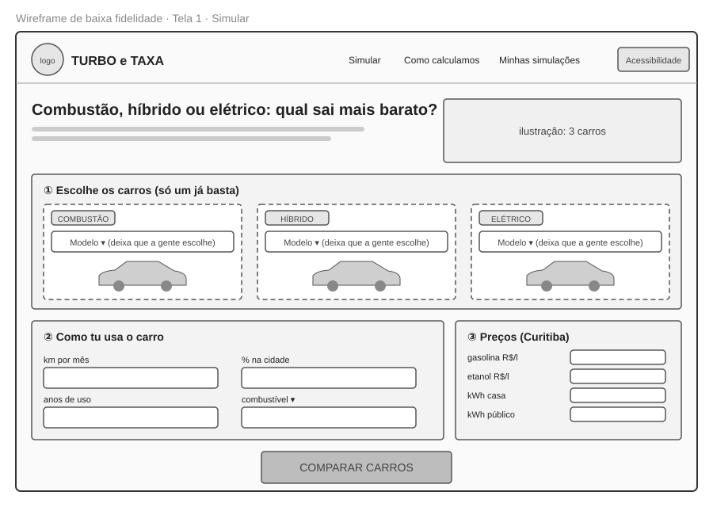

**Tela 2 · Resultado da comparação**

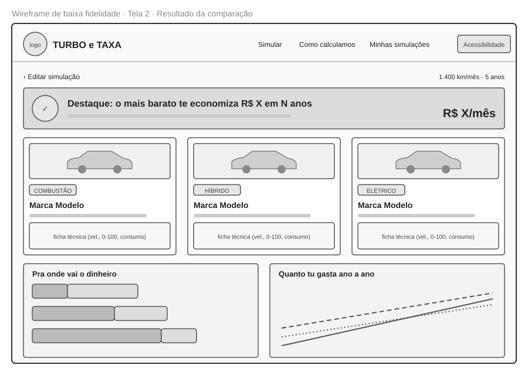

**Tela 3 · Minhas simulações e salvar**

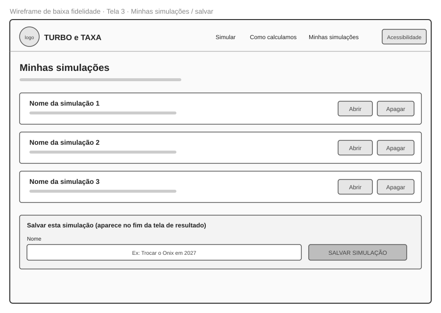

## 5. Protótipo de alta fidelidade

A interface final foi construída direto no código (HTML, CSS e JavaScript), seguindo o [guia de estilo](04-guia-de-estilo.md). As capturas abaixo são do sistema rodando localmente.

> Link do protótipo no Figma (opcional): _colar aqui se a equipe publicar uma versão no Figma_

| Simular | Resultado |
|---|---|
| 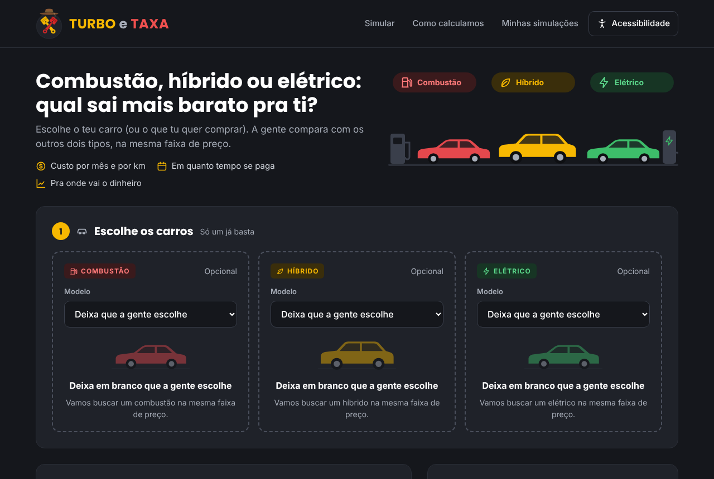 | 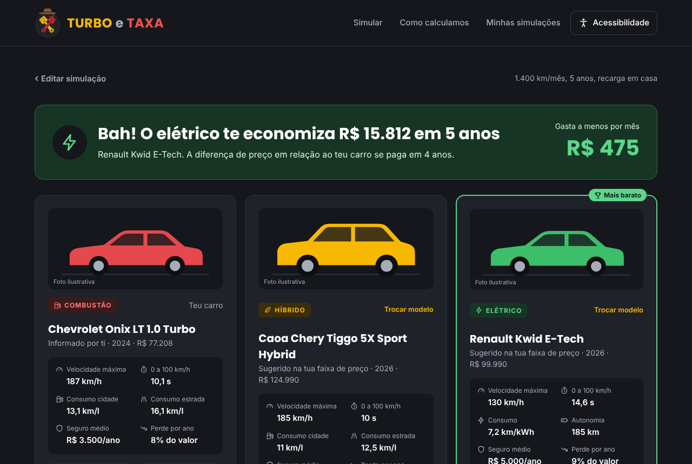 |

| Gráfico ano a ano | Como calculamos |
|---|---|
| 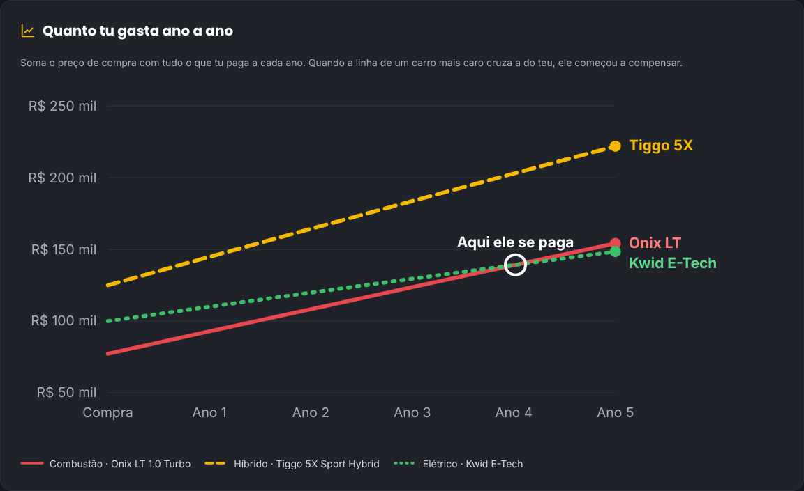 | 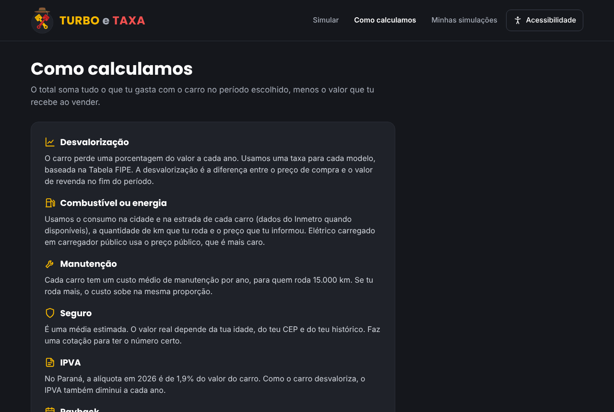 |

| Minhas simulações | Acessibilidade | Celular |
|---|---|---|
| 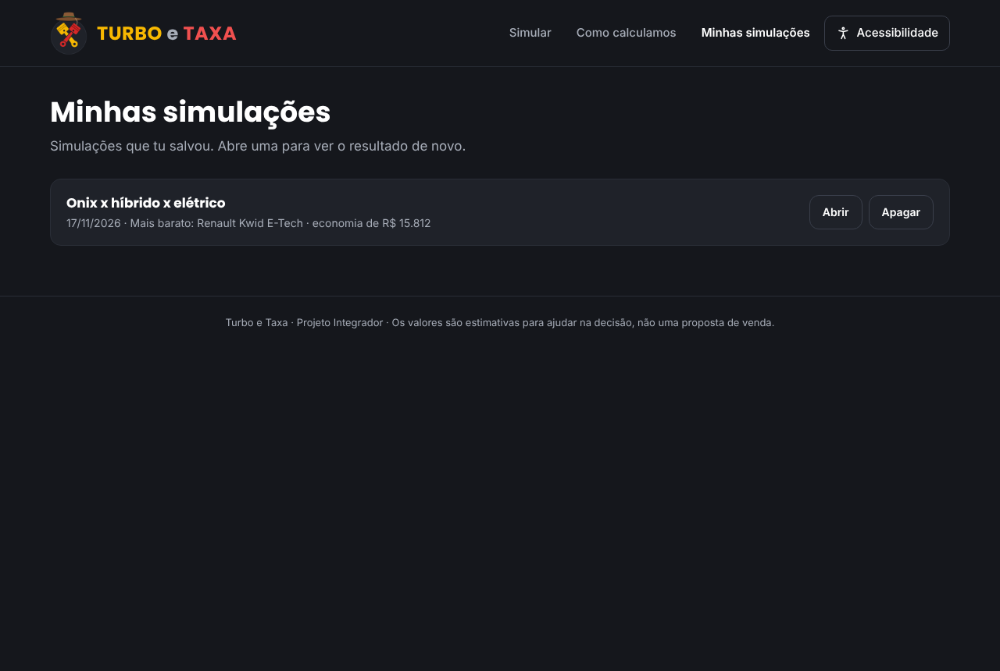 | 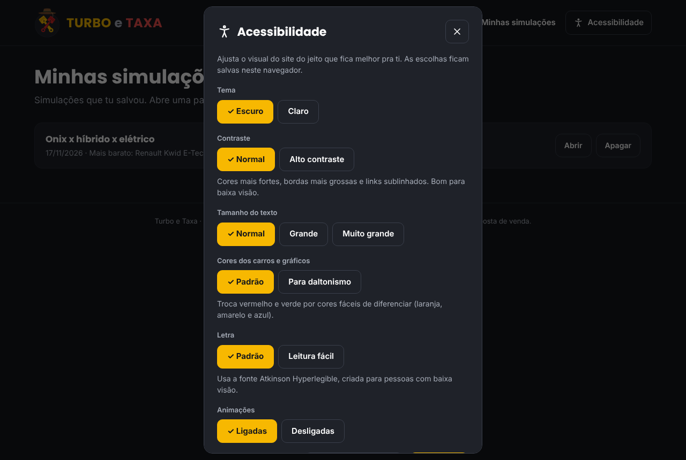 | 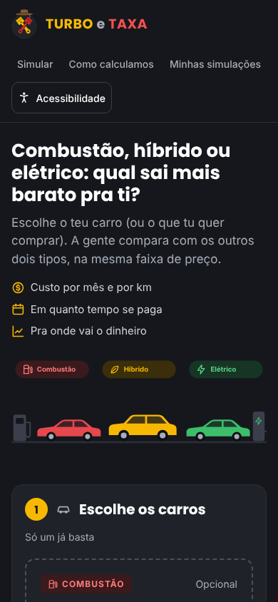 |

## 6. Decisões de design

- **Uma pergunta só no topo** ("qual sai mais barato pra ti?") para reduzir o abandono apontado na pesquisa.
- **Destaque em reais** logo no começo do resultado: a pesquisa mostra engajamento 3x maior quando a economia aparece de forma direta.
- **Cores por tipo de carro** (vermelho combustão, amarelo híbrido, verde elétrico) sempre acompanhadas de texto e ícone, nunca só a cor.
- **Linhas com traços diferentes** no gráfico (contínua, tracejada, pontilhada) para quem não distingue cores.
- **Linguagem gaúcha e próxima** ("Bah!", "tu"), alinhada à identidade da marca.
- **Tema escuro por padrão**, com tema claro e alto contraste no painel de acessibilidade.
