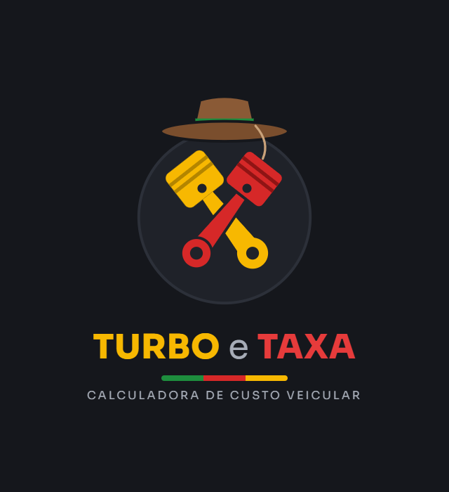

# Marca e Guia de Estilo

[← Voltar ao README](../README.md) · Anterior: [Design UI/UX](03-design-ux.md) · Próxima: [MVP e validação](05-mvp-e-validacao.md)

## 1. Conceito da marca

**Turbo e Taxa** junta as duas coisas que pesam na escolha de um carro: o desempenho (**turbo**) e o custo (**taxa**). A marca tem sotaque gaúcho ("Bah!", "pra ti", "tu"), é direta e fala como um amigo que entende de carro.

- **Missão:** ajudar qualquer pessoa a descobrir, em poucos minutos, qual carro sai mais barato para o jeito que ela usa.
- **Tom de voz:** simples, próximo, bem-humorado e honesto sobre o que é estimativa.
- **Slogan:** Calculadora de custo veicular.

## 2. Logotipo

| Elemento | Significado |
|---|---|
| Dois pistões cruzados (amarelo e vermelho) | O mundo automotivo e a comparação entre dois caminhos |
| Chapéu campeiro | A identidade gaúcha da marca |
| Faixa verde, vermelha e amarela | Cores da bandeira do Rio Grande do Sul e as três cores dos tipos de carro |
| Círculo escuro | Selo, transmite confiança |

**Versões:** logo completo (`static/img/logo.png`, 640×700) e emblema (`static/img/emblema.png`, usado no topo do site e como ícone da aba).

**Uso correto:** sempre sobre fundo escuro (`#15171C`) ou claro com contraste suficiente; manter a palavra "TURBO" em amarelo e "TAXA" em vermelho; não distorcer nem trocar as cores.

## 3. Cores

### Marca

| Cor | Hex | Uso |
|---|---|---|
| Amarelo destaque | `#F7B801` | Botões principais, foco, número dos passos, "TURBO" |
| Vermelho logo | `#F0504F` | "TAXA" |
| Fundo | `#15171C` | Fundo da página (tema escuro) |
| Superfície | `#1F2229` | Blocos e cartões |
| Texto | `#FFFFFF` | Texto principal |
| Texto de apoio | `#A7ADB8` | Dicas e legendas |

### Tipos de carro

| Tipo | Cor padrão | Cor para daltonismo (Okabe-Ito) | Ícone |
|---|---|---|---|
| Combustão | `#E5484D` | `#D55E00` (laranja) | Bomba de combustível |
| Híbrido | `#F7B801` | `#F0E442` (amarelo) | Folha |
| Elétrico | `#3DBE6A` | `#0072B2` (azul) | Raio |

### Estados

| Estado | Texto | Fundo |
|---|---|---|
| Bom / economia | `#5BD68A` | `#173524` |
| Ruim / gasta mais | `#FF7A7A` | `#3A1A1C` |
| Erro de formulário | `#FFB3B3` | `#3A1A1C` |

Todas as cores ficam em variáveis CSS no começo do `static/css/style.css`. Os temas (claro, alto contraste, daltonismo) só trocam os valores dessas variáveis.

## 4. Tipografia

| Uso | Fonte | Pesos |
|---|---|---|
| Títulos | **Poppins** | 600, 700, 800 |
| Texto e interface | **Inter** | 400, 500, 600, 700 |
| Modo "leitura fácil" | **Atkinson Hyperlegible** | 400, 700 |

Tamanho base: 16 px, altura de linha 1,5. Os modos "texto grande" e "muito grande" aumentam a base.

## 5. Componentes

| Componente | Regra |
|---|---|
| Botão principal | Fundo amarelo `#F7B801`, texto escuro, altura mínima 52 px, cantos de 12 px |
| Botão secundário | Fundo transparente, borda `#3A3F4B`, altura mínima 44 px |
| Bloco / cartão | Fundo de superfície, borda de 1 px, cantos de 16 px |
| Etiqueta de tipo | Texto em maiúsculas, ícone + cor do tipo, cantos de 6 px |
| Campo de formulário | Rótulo sempre visível acima do campo, altura mínima 44 px |
| Foco | Contorno amarelo de 3 px (4 px no alto contraste) |

Ícones: desenhados em SVG no `app.js` (traço de 2 px, cantos arredondados), sempre acompanhados de texto.

## 6. Acessibilidade

- Alvos de toque com no mínimo 44 px.
- Informação nunca depende só da cor: etiquetas têm texto e ícone, o payback tem ✓ ou ✗, as linhas do gráfico têm traços diferentes.
- Alto contraste com bordas grossas e links sublinhados.
- Respeita as preferências do sistema: `prefers-contrast: more` e `prefers-reduced-motion: reduce`.
- Navegação completa pelo teclado, com foco visível.
