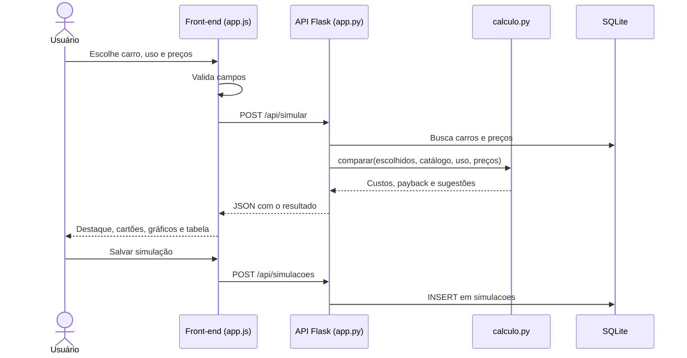

# Fase 3 · MVP e Validação

[← Voltar ao README](../README.md) · Anterior: [Guia de estilo](04-guia-de-estilo.md) · Próxima: [Roteiro da apresentação](06-roteiro-apresentacao.md)

## 1. Proposta de valor

> Para quem vai comprar ou trocar de carro e está em dúvida entre combustão, híbrido e elétrico, o **Turbo e Taxa** mostra em poucos minutos **qual sai mais barato no jeito que a pessoa usa**, com o custo por mês, o custo por km e em quanto tempo a diferença de preço se paga.

## 2. Escopo do MVP

O MVP cobre o **fluxo principal**: escolher um carro → informar o uso → ver a comparação → salvar.

| Entra no MVP | Fica para depois |
|---|---|
| Catálogo com 11 carros (4 combustão, 3 híbridos, 4 elétricos) | Catálogo completo e atualização pela Tabela FIPE |
| Sugestão automática por faixa de preço | Filtros avançados (carroceria, marca, autonomia) |
| Cálculo de custo total, custo por mês, por km e payback | Financiamento e juros |
| Preços de Curitiba editáveis | Preços por cidade e estado |
| Salvar, abrir e apagar simulações (SQLite) | Login e sincronização entre aparelhos |
| Painel de acessibilidade | Leitor de voz próprio |
| Versão de avaliação em um único HTML e executável `.exe` | Publicação na internet |

## 3. Fluxo principal



## 4. Especificação técnica

| Camada | Tecnologia | Arquivos |
|---|---|---|
| Front-end | HTML5, CSS3 (variáveis, grid, flex), JavaScript puro | `static/index.html`, `static/css/style.css`, `static/js/app.js` |
| Back-end | Python 3.10+ com Flask 3 | `app.py` (rotas e validação), `calculo.py` (regras de cálculo) |
| Banco de dados | SQLite (tabelas `veiculos`, `precos_regiao`, `simulacoes`) | `database.py` |
| Testes | `unittest` (13 testes: 11 de cálculo, 2 de API ponta a ponta) | `tests/test_calculo.py` |
| Distribuição | Scripts de início, PyInstaller (`.exe`) e versão em HTML único | `iniciar.bat`, `iniciar.sh`, `gerar_exe.bat`, `avaliacao/index.html` |

Detalhes da arquitetura, da API e das fórmulas estão no [README](../README.md#arquitetura).

## 5. Validação

### 5.1 Testes automáticos

```bash
python -m unittest discover tests -v
```

Resultado esperado: `Ran 13 tests ... OK`.

### 5.2 Teste de usabilidade (roteiro)

Aplicar com 1 ou 2 pessoas do público-alvo, de preferência as mesmas da pesquisa de campo. Pedir para a pessoa pensar em voz alta e não ajudar durante as tarefas.

| # | Tarefa | Critério de sucesso |
|---|---|---|
| T1 | "Descubra se trocar o seu carro por um elétrico vale a pena." | Chega na tela de resultado sem ajuda |
| T2 | "Em quanto tempo o carro mais caro se paga?" | Encontra o payback ou o ponto no gráfico ano a ano |
| T3 | "Mude para 2.000 km por mês e compare de novo." | Usa "Editar simulação" e refaz a comparação |
| T4 | "Salve essa simulação e abra de novo." | Encontra "Minhas simulações" e abre a simulação |
| T5 | "Deixe o texto maior e o fundo claro." | Usa o painel de Acessibilidade |

### 5.3 Registro dos testes

> Preencher com o que aconteceu de verdade.

| Participante | T1 | T2 | T3 | T4 | T5 | Comentários e dificuldades |
|---|---|---|---|---|---|---|
| P1 | _ok / com ajuda / não fez_ | | | | | |
| P2 | | | | | | |

**Ajustes feitos depois dos testes:** _listar aqui._
